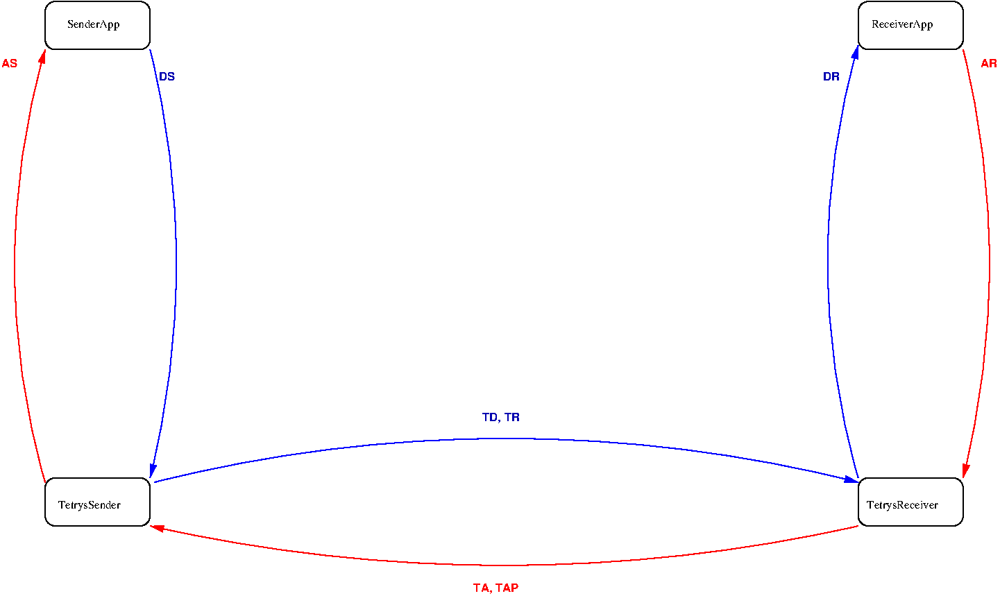
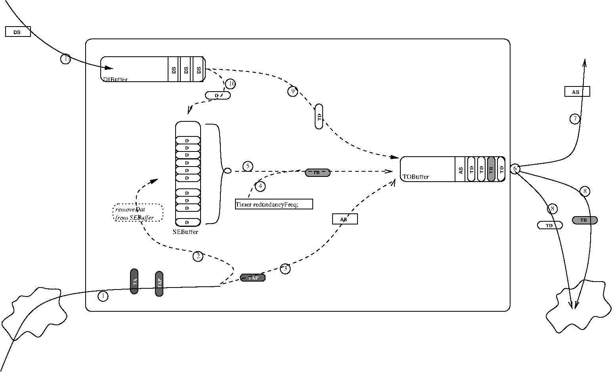
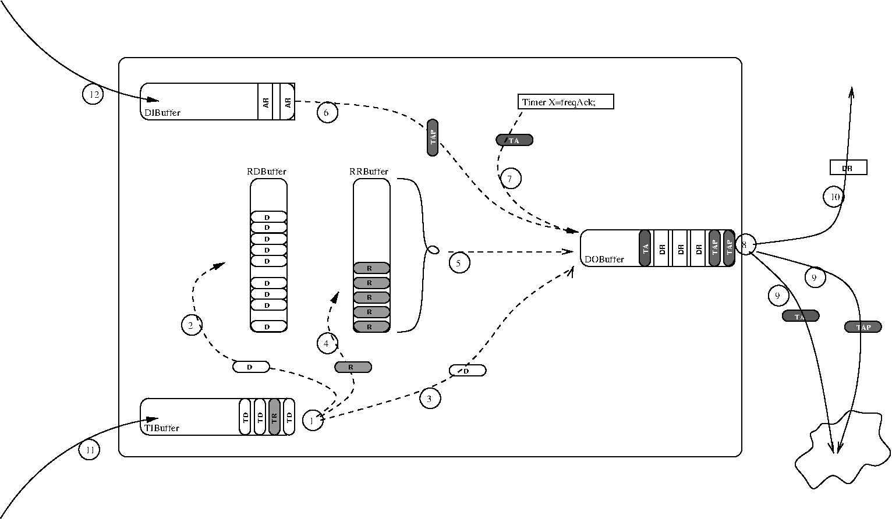
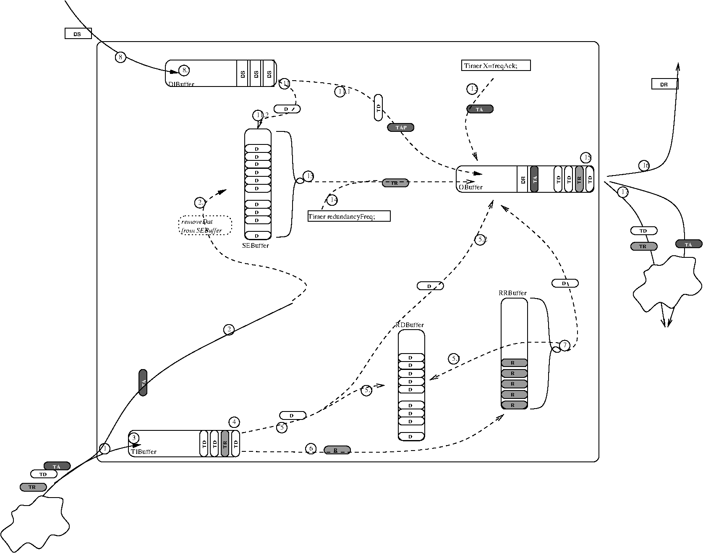

# Tetrys

Tetrys is an **on-the-fly erasure-coding (network-coding) protocol** for
real-time applications over lossy links. Instead of grouping packets in
fixed FEC blocks, the sender continuously produces *repair packets* that are
random linear combinations of all the data packets that the receiver has not
acknowledged yet. A lost data packet is rebuilt as soon as enough repair
packets have arrived, without waiting for the end of a block and without
retransmission.

This repository contains the reference C implementation:

* a **core library** (`src/tetrys_core`) that implements the protocol state
  machines, the buffers, the finite-field coding and the decoder;
* a **UDP module** (`src/modules/udp`) with a file / traffic generator
  (`tetrys_generate_udp`) that sends or receives a stream through Tetrys over
  UDP;
* a **TUN module** (`src/modules/tuntap`) that carries IP packets read from a
  Linux TUN interface through Tetrys (`tetrystunnel_udp`).

> This is research code. It has no authentication or encryption and has not
> been hardened for use on untrusted networks.

---

## Table of contents

1. [Origin, authors and copyright](#origin-authors-and-copyright)
2. [How to cite](#how-to-cite)
3. [How Tetrys works](#how-tetrys-works)
4. [Source tree](#source-tree)
5. [Building](#building)
6. [Important parameters and options](#important-parameters-and-options)
7. [Module 1: UDP traffic generator](#module-1-udp-traffic-generator-tetrys_generate_udp)
8. [Module 2: TUN tunnel](#module-2-tun-tunnel-tetrystunnel_udp)
9. [Writing a new module](#writing-a-new-module)
10. [Statistics and debugging](#statistics-and-debugging)
11. [Tests](#tests)
12. [Documentation](#documentation)
13. [Known limitations](#known-limitations)
14. [License](#license)

---

## Origin, authors and copyright

This code comes from the PhD work of **Pierre-Ugo Tournoux**, available at
<https://theses.hal.science/tel-00547003/>. It was developed at **ISAE**
(Institut Sup&eacute;rieur de l'A&eacute;ronautique et de l'Espace,
Toulouse, France) in the context of a DMIA project (Department of
Mathematics, Computer Sciences and Control Theory).

```
Copyright (C) 2011 Jerome Lacan, Emmanuel Lochin, Pierre-Ugo Tournoux, 2011 ISAE
```

The finite-field arithmetic and the Vandermonde-matrix code in
`src/tetrys_core/fec.c` are based on the `fec.c` forward-error-correction
library by **Luigi Rizzo** (&copy; 1997-98 Luigi Rizzo), itself derived from
code by Phil Karn, Robert Morelos-Zaragoza and Hari Thirumoorthy. The original
copyright notice and BSD-style licence terms are kept at the top of that file
and must be preserved in any redistribution. The matrix-inversion routine and
the Tetrys-specific encoding and decoding functions of `fec.c` are by
Jerome Lacan and the Tetrys authors.

The Tetrys code is distributed under the GNU General Public License
(see [License](#license)).

## How to cite

**If you use this code in a publication, please cite the following paper**
(<https://ieeexplore.ieee.org/document/5729366>):

> P. U. Tournoux, E. Lochin, J. Lacan, A. Bouabdallah and V. Roca,
> "On-the-Fly Erasure Coding for Real-Time Video Applications,"
> *IEEE Transactions on Multimedia*, vol. 13, no. 4, pp. 797-812, Aug. 2011,
> doi: 10.1109/TMM.2011.2126564.

```bibtex
@article{Tournoux2011OnTheFly,
  author    = {Tournoux, Pierre Ugo and Lochin, Emmanuel and Lacan, J{\'e}r{\^o}me
               and Bouabdallah, Amine and Roca, Vincent},
  title     = {On-the-Fly Erasure Coding for Real-Time Video Applications},
  journal   = {IEEE Transactions on Multimedia},
  volume    = {13},
  number    = {4},
  pages     = {797--812},
  month     = aug,
  year      = {2011},
  doi       = {10.1109/TMM.2011.2126564},
  url       = {https://ieeexplore.ieee.org/document/5729366}
}
```

Related reading: the protocol was later described as an IETF document, RFC 9407,
*"Tetrys: An On-the-Fly Network Coding Protocol"* (J. Detchart, E. Lochin,
J. Lacan, V. Roca, 2023). This repository is the 2011 research implementation;
it is not guaranteed to be wire-compatible with that RFC.

---

## How Tetrys works

### Principle

Two applications talk through Tetrys: a **SenderApp** and a **ReceiverApp**.
Each one has its Tetrys endpoint, and the two endpoints exchange the following
packets (names as in the figures of `doc/`):



| Packet | Constant | Direction | Content |
|---|---|---|---|
| DS | `PORT_DS` | SenderApp &rarr; Tetrys sender | Application packet to protect |
| TD | `PORT_TD` | sender &rarr; receiver | Data packet, with a sequence number |
| TR | `PORT_TR` | sender &rarr; receiver | Repair: linear combination of the data of a window `[min_redundancy, max_redundancy]` |
| TA | `PORT_TA` | receiver &rarr; sender | ACK-only packet, sent every `ack_freq` |
| TAP | `PORT_TAP` | receiver &rarr; sender | A packet of the ReceiverApp (AR) wrapped with a piggybacked ACK |
| DR | `PORT_DR` | Tetrys receiver &rarr; ReceiverApp | Data delivered (received or rebuilt) |
| AR | `PORT_AR` | ReceiverApp &rarr; Tetrys receiver | Application packet sent back to the sender side |
| AS | `PORT_AS` | Tetrys sender &rarr; SenderApp | Payload of a received TAP, delivered to the SenderApp |
| TAD, TAR | `PORT_TAD`, `PORT_TAR` | both ways (role 0) | TD / TR with an ACK piggybacked in the packet itself |

Data flows from the SenderApp to the ReceiverApp; the receiver endpoint only
sends acknowledgements (and, optionally, the packets of its own application).

### Encoding (sender)

* Each application packet is copied into the **encoding window** (`SEBuffer`)
  and sent immediately as a data packet. The data area (`PLS` = 1304 bytes)
  starts with an `int` of padding, followed by the application payload.
* After `k` data packets (configured via `fec_n = k - 1`), the sender builds a **repair packet**: a linear
  combination, over **GF(2^8)**, of all the data packets of the window that
  have not been acknowledged yet. The coefficients are pseudo-random (a
  Park-Miller generator seeded by the repair id, see `rand31.c`), so the
  receiver can recompute them from the repair id and the window bounds.
  Vector multiply-accumulate (`dst ^= c * src` over GF(2^8)) uses runtime CPU
  dispatch in `init_fec()` (`src/tetrys_core/fec.c`): on x86_64, it selects
  32-byte **AVX2** (`_mm256_shuffle_epi8`) or 16-byte **SSSE3**
  (`_mm_shuffle_epi8`) kernels over 4-bit split multiplication tables, with a
  portable C11 scalar fallback elsewhere.
* ACKs let the sender **slide the window**: data older than the acknowledged
  point are removed from the `SEBuffer`, so the code only ever combines
  recent, still useful packets.
* An optional timer (`rep_freq`) sends an extra repair while packets are still
  unacknowledged, so the last packets of a flow, or a lost repair, are still
  protected.

### Decoding (receiver)

1. Received data are stored in the `RDBuffer`, repairs in the `RRBuffer`.
   A gap in the sequence numbers reveals lost packets.
2. The known data packets are **subtracted** from the stored repairs
   (`subtract_all`), so that each repair only depends on the lost packets.
3. When enough repairs are available, the matrix of coefficients is built and
   **inverted** by Gauss-Jordan elimination over GF(2^8) (`invert_mat`).
   A repair that is linearly dependent on the others is discarded and the
   decoding is retried with the next repairs.
4. The lost packets are recomputed and inserted in the `RDBuffer`.
5. With in-order delivery (default), `send_dat_in_order()` hands the packets to
   the application strictly in sequence order; a hole blocks the delivery
   until it is filled.
6. **ACK generation is purely timer-driven (plus piggybacking)**: the receiver
   sends a **cumulative ACK** (`PORT_TA`) strictly on a periodic timer
   (`ack_freq = 0.05 s` via `ITIMER_REAL`/`SIGALRM`), rather than counting
   received packets. Whenever the receiver has return application data
   (`PORT_AR`) to emit, it immediately **piggybacks** the cumulative ACK in a
   `PORT_TAP` packet and resets the `ack_freq` timer. Each ACK reports the point
   up to which everything has been received or rebuilt (minus a small safety
   margin).

### Buffers

| Buffer | Role |
|---|---|
| `DIBuffer` | Application data waiting to be encoded and sent |
| `SEBuffer` | Sender encoding window (sent, not yet acknowledged data) |
| `OBuffer` | Output queue: packets ready to be sent on the wire or delivered |
| `TIBuffer` | Tetrys input: packets received from the network |
| `RDBuffer` | Receiver data: received and rebuilt data packets |
| `RRBuffer` | Receiver repairs: repair packets waiting for decoding |
| `FOBuffer`, `tmpFec*` | Block-FEC mode only |

### Figures: buffers and procedures

The Xfig sources are in `doc/*.fig` and their PNG exports in `doc/img/`
(`make figs` regenerates them, `fig2dev` is required). The numbers in the
figures are the steps quoted in the comments of the main loops (for example
"Step 3" for `treat_ti_buffer()`); the table mapping each step to its function
is in the generated Doxygen main page (`make doc`).

**Sender**



**Receiver**



**Sender and receiver in the same process** (step numbers used in the code)



Reading guide: the figures call the sender output buffer *TOBuffer* and the
receiver one *DOBuffer*, whereas the code has a single `OBuffer`; the timers
*redundancyFreq* and *freqAck* are `rep_freq` and `ack_freq`. The figures show the
sliding-window mode only. The legend is in `doc/img/tetrysLegend.png`.

### Main loop

Every module runs the same single-step engine loop via `tetrys_step_once()` (called inside `tetrys_main_run()`):

```c
wait_for_input();              /* pselect() on the registered input descriptors  */
tetrys_process_pending_alarm();/* handle SIGALRM timers (periodic ACK / repair)  */
treat_ti_buffer();             /* process received data / repair / ACK packets   */
send_dat_in_order();           /* deliver the packets that are now in sequence   */
treat_o_buffer();              /* send / deliver everything in the OBuffer       */
treat_di_buffer();             /* encode the application data, emit repairs      */
treat_o_buffer();
tetrys_check_end_transfer();   /* flush end-of-transfer ACKs when requested      */
```

Two `SIGALRM` timers drive the periodic ACK (receiver) and the periodic repair
(sender). There is one global Tetrys context (`struct TETRYS *tetrys`).

### Roles and modes

* **Role 1**: sender. **Role 2**: receiver. **Role 0**: both directions at the
  same time (ACKs are piggybacked on data and repairs).
* **Tetrys mode** (`fecMode = 0`, the default of both modules): sliding-window
  coding described above.
* **Block-FEC mode** (`fecMode = 1`): classical block coding where `n` data
  packets are followed by `k - n` repair packets (code in
  `try_to_decode_fec_mode`). No bundled module enables it.

---

## Source tree

```
src/tetrys_core/          Core library
    tetrys_main_lib.c/.h    State machine: init, input/output processing, encoding
                            triggers, decoding, in-order delivery
    rcv_automate.c/.h       Receiver state updates on data / repair / ACK reception
    circularBuffer.c/.h     Sorted circular buffers (all the buffers above)
    fec.c/.h                GF(2^8) arithmetic, matrix inversion, encode (Rizzo-based)
    rand31.c/.h             Park-Miller pseudo-random generator for the coefficients
    stats.c                 Optional statistics (-DSTATS)
    common.c/.h             Sockets, helpers, option parsing
    common_struct_def.h     Constants, PDU and TETRYS structures
src/modules/udp/          UDP module and the file / traffic generator
src/modules/tuntap/       TUN tunnel
test/                     Test scripts and the packet-loss shim
doc/                      Doxygen configuration, main page, Xfig figures (img/ = PNG exports)
Makefile                  Single build file
COPYING                   Full text of the GNU General Public License v3
LICENCE.TXT               Licence notice and authors (GNU GPL v3 or later)
```

---

## Building

Requirements: Linux, GNU make, a C compiler accepting `-std=gnu11` (GCC or
Clang), `pthread` and `libm`. On x86_64, `fec.c` includes optional
runtime-dispatched SSSE3/AVX2 acceleration for GF(2^8) operations with a
portable C11 scalar fallback on other architectures or CPUs. The TUN module
needs `/dev/net/tun`. Doxygen is optional.

```sh
make            # optimised build  -> bin/tetrys_generate_udp, bin/tetrystunnel_udp
make debug      # -O0 -g3 -DDEBUG  -> bin-debug/
make asan       # AddressSanitizer + UBSan -> bin-asan/
make shim       # packet-loss LD_PRELOAD shim -> build/loss_shim.so
make figs       # regenerate doc/img/*.png from doc/*.fig (needs fig2dev)
make doc        # Doxygen HTML -> build-doc/html/index.html
make doc-check  # same, but fail on any Doxygen warning
make clean      # remove every build*/ and bin*/ directory
```

The code compiles without warnings with `-Wall -Wextra -Wpedantic
-Wstrict-prototypes`. Extra flags can be passed with `EXTRA_CFLAGS`, for
example `make EXTRA_CFLAGS="-DVERBOSE -DSTATS"`. Each variant (`debug`, `asan`)
has its own object and binary directory, and dependencies on the headers are
tracked.

---

## Important parameters and options

### Coding parameters

| Name | Where | Meaning |
|---|---|---|
| `n` (`fec_n`) | `-n` / `-k` | Core repair cadence parameter, mapped by both CLI modules to `fec_n = k - 1` (`2 <= k < n`): a repair packet is emitted once more than `fec_n` data packets were sent since the previous one, i.e. **one repair every `k` data packets**. A smaller `k` means more redundancy |
| `k` (`fec_k`) | `-n` / `-k` | Core redundancy count `n - k`; used only in block-FEC mode (`fecMode=1`) |
| `PLS` | `common_struct_def.h` | Size of the data area of a packet: **1304 bytes**, of which 4 bytes hold the padding header, i.e. **up to 1300 bytes of application payload** |
| `GF_BITS` | `common_struct_def.h` | Field size: GF(2^8) |
| `ack_freq` | `tetrys_init_all` | ACK period of the receiver (0.05 s) |
| `rep_freq` | `tetrys_init_all` | Period of the extra repair while data are unacknowledged (0.1 s) |
| `deliverInOrder` | `tetrys_init_all` | 1: deliver strictly in order (set by both modules); 0: deliver as received or decoded |
| `fecMode` | `tetrys_init_all` | 0: Tetrys sliding window; 1: block FEC |

Packets travel in a fixed-size structure (`struct PDU`, 1400 bytes), so every
Tetrys packet is sent as one UDP datagram of that size.

### Compile-time options

Pass them with `EXTRA_CFLAGS="-DNAME"`.

| Flag | Effect |
|---|---|
| `VERBOSE` | Informational messages (initialisation, decoder events) |
| `STATS` | Collect statistics and write `sndStat_*.stats` / `rcvStat_*.stats` |
| `DECODEINORDER` | Attempt a decoding only when there are at least as many repair packets as lost packets (no incremental search for a smaller decodable subset) |
| `SAVEPACKET` | Log every sent / received packet to `pktSaved.tr` |
| `ALLOWZEROCOEF` | Allow zero coefficients in the repair combinations (by default coefficients are non-zero) |
| `BINAIRE` | Use binary (0/1) coefficients instead of GF(2^8) coefficients |
| `MONITOR` | Write the coding traces described [below](#monitor-traces) in the working directory (disabled by default) |

Debug trace levels are selected with the `PR_DB`, `PR_DB_1` and `PR_DB_2`
macros of `common_struct_def.h`.

---

## Module 1: UDP traffic generator (`tetrys_generate_udp`)

Sends a file (or a generated pattern) through Tetrys over UDP, or receives it
and writes it to a file. Run a receiver, then a sender.

```
tetrys_generate_udp [-f file] [-i usec] [-s bytes] -m role [-n n] [-k k] [-q count] host port
```

| Option | Meaning |
|---|---|
| `-m 1` / `-m 2` | Role: **1 = sender**, **2 = receiver** (mandatory) |
| `-f file` | Sender: file to send. Receiver: file to write. Without `-f` the sender generates a counter pattern |
| `-i usec` | Sender: delay between two packets in microseconds (0 = as fast as possible) |
| `-s bytes` | Payload size per packet (default 1000; keep it at 1300 or below, see `PLS`) |
| `-n n` | Sender: coding parameter, 1 to 255 (see below) |
| `-k k` | Sender: coding parameter, 1 to 255 (see below; requires `2 <= k < n`) |
| `-q count` | Sender: stop after `count` packets when generating a pattern without `-f` |
| `host port` | Sender: destination address and UDP port. Receiver: the port to listen on (the host argument is required but not used) |

`-n` and `-k` are required on the sender (`2 <= k < n`). They define the code
rate: the generator turns them into `fec_n = k - 1` (one repair for every `k`
data packets). For example `-n 5 -k 4` gives one repair for every 4 data packets.

Example (loopback, 10 % of packet loss injected with the shim):

```sh
# terminal 1: receiver
bin/tetrys_generate_udp -f rebuilt.tr -s 1000 -m 2 127.0.0.1 12345
# terminal 2: sender, one 1000-byte packet every 5 ms, one repair per 4 packets
bin/tetrys_generate_udp -f ./test1Mo.tr -i 5000 -s 1000 -m 1 -n 5 -k 4 127.0.0.1 12345
cmp test1Mo.tr rebuilt.tr
```

### End-of-transfer & connection teardown

The Tetrys core protocol has **no protocol-level teardown** (no `FIN`/`FIN-ACK`
packets); `tetrys_generate_udp` implements an application-level closing
procedure instead:

1. At the end of the input file or `-q` count, the sender calls
   `tet_end_transfer()`, which speeds up periodic repairs (`rep_freq = 10 ms`)
   until every sent data packet is acknowledged.
2. The sender then transmits **5 application sentinel packets** of `sizeof(int)`
   bytes containing `6666` (50 ms apart), stops its protocol thread, closes the
   input file, and frees all resources (`tetrys_cleanup()`, `cleanup_module_tetudp()`).
3. Upon receiving the `6666` sentinel, the receiver exits its loop, closes the
   output file, and cleans up memory. If all 5 sentinels are lost in flight,
   the receiver stays running until terminated with `SIGINT`/`SIGTERM`.

Both processes print the number of bytes and packets generated and received at
shutdown.

> Each process uses its own unnamed POSIX semaphore for local flow control, and
> the sender binds UDP `port + 1` while the receiver binds `port`. **Concurrent
> transfers on the same host must therefore use distinct UDP port pairs** (at
> least 2 apart).

---

## Module 2: TUN tunnel (`tetrystunnel_udp`)

Reads IP packets from a Linux TUN interface on one side, sends them through
Tetrys over UDP, and writes the rebuilt packets to the TUN interface on the
other side.

```
tetrystunnel_udp -i <ifname> -c <serverIP> [-p port] [-n n] [-k k]     # sender (client)
tetrystunnel_udp -i <ifname> -s [-p port]                              # receiver (server)
tetrystunnel_udp -h
```

| Option | Meaning |
|---|---|
| `-i ifname` | TUN interface to open (mandatory). It must exist or the program must be allowed to create it |
| `-c serverIP` | Sender mode: address of the receiver |
| `-s` | Receiver mode |
| `-p port` | UDP port of the Tetrys traffic (default 30001) |
| `-n n` | FEC block length `n` (1 to 255, default 10, sender only; requires `2 <= k < n`) |
| `-k k` | FEC data symbols `k` (1 to 255, default 8, sender only): mapped to `fec_n = k - 1` (one repair every `k` data packets) |
| `-h` | Help |

Points to know:

* **Forward FEC, uncoded return**: forward traffic (client TUN &rarr; server TUN)
  is FEC-protected (`TD`/`TR` &rarr; `DR`). Return traffic (server TUN &rarr;
  client TUN, such as ICMP echo replies for `ping`) travels piggybacked in
  `TAP` packets and is delivered to the client TUN via `PORT_AS` without FEC
  protection.
* Opening a TUN device needs `CAP_NET_ADMIN` (run as root or with `sudo`), or a
  persistent device created beforehand with `ip tuntap add`.
* A Tetrys packet carries at most 1300 bytes of payload, and larger IP packets
  read from the TUN are not carried correctly. **Set the MTU of the interface
  to 1300 or less** (the test script uses 1280).
* **End-of-burst repair recovery and signal-based shutdown**: the tunnel runs
  as a continuous daemon with no session teardown (`tet_end_transfer()` is not
  used). While data remain unacknowledged in `SEBuffer`, the sender's periodic
  timer (`rep_freq = 0.1 s`) keeps emitting `TR` packets over
  `[min_seq_in_red, max_seq_in_red]`, so even the last packet of a burst (for
  example the final packet of a `ping` sequence) is recovered if lost. Because
  `scan_tetrys_ack()` keeps an `ack - 2` window margin, a small idle keepalive
  rate (`1 TR / 0.1 s` and `1 TA / 0.05 s`) persists once traffic has started.
  Shut down either endpoint cleanly with **`SIGINT`, `SIGTERM`, or `SIGQUIT`**,
  which disarms timers, prints the per-type packet counters (`TD`, `TR`, `TA`,
  `TAD`, `TAR`, `TAP`, `DR`, `AS`), closes the UDP socket and TUN fd, and frees
  all memory (`cleanup_module_tettun()`, `tetrys_cleanup()`).

Minimal manual example (two namespaces, see `test/tetrysnetns.sh` for the
complete setup):

```sh
# server side (namespace ns1), tun0 = 192.168.10.2
sudo ip netns exec ns1 bin/tetrystunnel_udp -i tun0 -s -p 30001
# client side, tun0 = 192.168.10.1, server reachable at 10.1.1.2
sudo bin/tetrystunnel_udp -i tun0 -c 10.1.1.2 -p 30001 -n 10 -k 8
# traffic: ping 192.168.10.2 or send UDP from 192.168.10.1 to 192.168.10.2
```

---

## Writing a new module

A module connects Tetrys to a data source and to the network by registering
handlers in two tables of the global context. The UDP and TUN modules are
complete examples (`init_context()` in each).

* **Input handlers** (`tetrys->fd_fun_tab[i] = {fd, handler}`, `nb_fd_fun`):
  `int handler(int fd, gf *pkt_to_parse)` reads one packet and returns
  `1` (application data, goes to the `DIBuffer`), `2` (Tetrys data or repair,
  goes to the `TIBuffer`), `3` (ACK, processed at once), `5` (nothing to read,
  try again) or `-1` (error). It must set `tetrys->incoming_length`.
* **Output handlers** (`tetrys->out_fun_tab[i] = {packet type, handler}`,
  `nb_out_fun`):
  `int handler(struct PDU *pdu)` sends the packet to the network (`PORT_TD`,
  `PORT_TR`, `PORT_TA`, `PORT_TAD`, `PORT_TAR`, `PORT_TAP`) or delivers it to the
  application (`PORT_DR`, `PORT_AS`).
* **Initialisation & lifecycle**: call `tetrys_alloc_globals(role, pkt_size)`
  (which initializes `tetrys`, `sig_AckRed`, GF(2^8) tables via `init_fec()`,
  and protocol state via `init_tetrys()`), configure `fec_n`, `fec_k`,
  `currentRole`, `fecMode`, `deliverInOrder` and the `sig_AckRed` timers,
  register input/output handlers, loop on `tetrys_step_once()`, then call
  `tetrys_cleanup()` at shutdown.
* The application payload layout inside a packet is `[int padding][payload]`
  (see `circ_add_data_in_buffer`); a handler that delivers a packet must use
  `datav + sizeof(int)` with `pls` bytes.

The public API of the core is documented with Doxygen (`make doc`).

---

## Statistics and debugging

* Build with `-DSTATS` to write per-session histograms and summaries:
  `sndStat_*.stats` (sender) and `rcvStat_*.stats` (receiver: encoding window
  lengths, ACK periods, loss events, inversion success / failure, recovery
  delay, `rcvStat_main.stats`).
* Build with `-DVERBOSE` for decoder events (for example the removal of a
  linearly dependent repair).
* Build with `-DMONITOR` to write coding traces (see [Monitor traces](#monitor-traces)).
  Without it, no `monitor*` file is created.
* `make asan` runs everything under AddressSanitizer and UBSan.

### Monitor traces

`-DMONITOR` (for example `make EXTRA_CFLAGS=-DMONITOR`) makes the library create
five files in the **current working directory** of each process, overwriting
existing ones, and exit if one of them cannot be created. It is disabled by
default.

| File | Written by | Content |
|---|---|---|
| `monitorFEC.snd` | sender | One line per data packet encoded in a repair: window bounds, packet, coefficient, repair id, first bytes of the repair and of the data |
| `monitorSub.rcv` | receiver | Subtraction of the known data from the repairs and the coefficients associated to each packet during the decoding attempts |
| `monitorCOEF.snd`, `monitorCOEF.rcv`, `monitorFEC.rcv` | | Created but **never written** by the current code: they stay empty |

These traces are very verbose and meant for debugging the coding and decoding
only; do not enable them for performance measurements.

---

## Tests

All test scripts are in `test/`. The loopback tests need no privilege except
where noted.

| Script | What it does |
|---|---|
| `test/regress_udp.sh` | Sequential loopback UDP transfers with injected packet loss; each output is compared with the source (`cmp`). Variables: `BIN_DIR`, `LOSS_PCT`, `N`, `K`, `RUNS`, `SIZE`, `PORT_BASE`, `INTERVAL_US`. Exit status 0 if every run is identical |
| `test/tetrysnetns.sh` | End-to-end test of the **TUN tunnel** in a network namespace (needs `sudo`, `ip`, `tc`, `python3`). Creates a veth pair and two TUN interfaces, applies `tc netem` delay and loss, sends a numbered UDP stream through the tunnel and reports the received count, the residual loss, the missing ranges, the receiver socket overflows, and the packet counters of both tunnel processes |
| `test/tunnelnetns.sh` | Persistent interactive launcher for the **TUN tunnel** across `ns1` (needs `sudo`, `ip`, `tc`). Sets up the veth pair, `tun0` interfaces, and `tc netem` delay/loss, leaves both endpoints running for `ping` or custom traffic, and tears down cleanly with `test/tunnelnetns.sh stop` |
| `test/test.sh` | Loopback file transfer with `tc` loss (needs `sudo`) |
| `test/loss_shim.c` | `LD_PRELOAD` library that drops a fraction of `sendto()` calls (`LOSS_PCT`, optional `LOSS_SEED`). Build with `make shim` |

`test/tetrysnetns.sh` parameters (environment variables): `N`, `K`,
`PKT_COUNT`, `PKT_SIZE`, `PKT_INTERVAL`, `DELAY_MS`, `LOSS_PCT`, `RCVBUF_KB`
(receive buffer of the application sink, default 4096 KB) and `TUNNEL` (path of
the binary). `test/tunnelnetns.sh` uses `N`, `K`, `DELAY_MS`, `LOSS_PCT`, and
`TUNNEL`. Examples:

```sh
LOSS_PCT=10 K=4 N=8 test/tetrysnetns.sh

LOSS_PCT=10 K=4 N=8 test/tunnelnetns.sh
ping -c 10 192.168.10.2
test/tunnelnetns.sh stop
```

Using the shim without privileges:

```sh
make shim
LD_PRELOAD=build/loss_shim.so LOSS_PCT=5 bin/tetrys_generate_udp ...
```

Note: when Tetrys fills a gap it releases the packets it was holding back in
one burst. A receiving application with a small socket buffer can drop part of
that burst after Tetrys, which looks like bursts of missing packets. That is
why the test sink uses a large buffer.

---

## Documentation

* API reference: `make doc`, then open `build-doc/html/index.html`
  (configuration in `doc/Doxyfile`). `make doc-check` fails if any public
  function or structure member is undocumented.
* Figures of the buffers and procedures: Xfig sources `doc/*.fig`, PNG exports
  in `doc/img/` (`make figs`), explained in the Doxygen main page
  (`doc/mainpage.dox`).

---

## Known limitations

* One global Tetrys context per process: one flow per process, and the
  library is not thread-safe (`tetrys_generate_udp` runs the protocol in a second thread
  and the application in the main one, without locking).
* The TUN tunnel only applies FEC to the forward path (client to server);
  return traffic (server to client) travels uncoded via `TAP` / `AS`.
* Maximum application payload of 1300 bytes per packet (`PLS` = 1304 including
  the padding header); the field is GF(2^8).
* A hole in the in-order delivery that no repair can fill blocks the packets
  behind it; the receiver stops with an error if it falls more than 50 packets
  behind its refresh point.
* No authentication, integrity protection or encryption of the packets.

---

## License

This program is free software: you can redistribute it and/or modify it under
the terms of the **GNU General Public License** as published by the Free
Software Foundation, either version 3 of the License, or any later version. It
is distributed in the hope that it will be useful, but **without any
warranty**; see the notice in [`LICENCE.TXT`](LICENCE.TXT), the full text
in [`COPYING`](COPYING) or at <https://www.gnu.org/licenses/>.

`src/tetrys_core/fec.c` is derived from the `fec.c` library of Luigi Rizzo and
keeps its original copyright notice and its BSD-style conditions, which
apply to that part of the code.

```
Copyright (C) 2011 Jerome Lacan, Emmanuel Lochin, Pierre-Ugo Tournoux, 2011 ISAE
```
